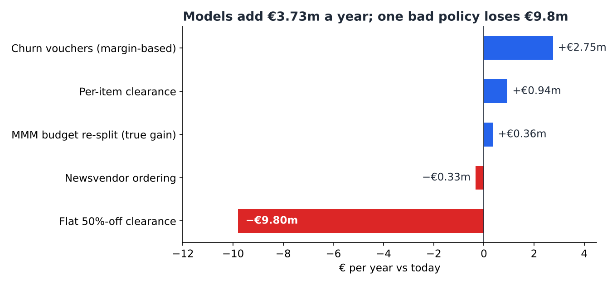
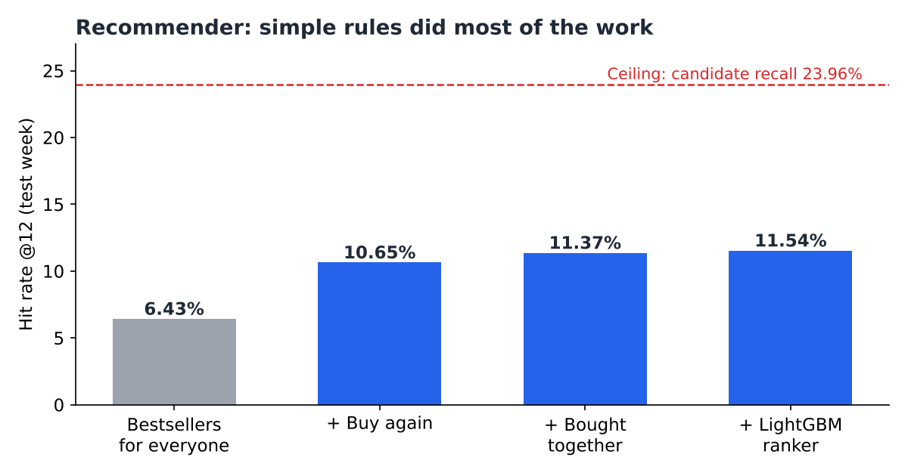
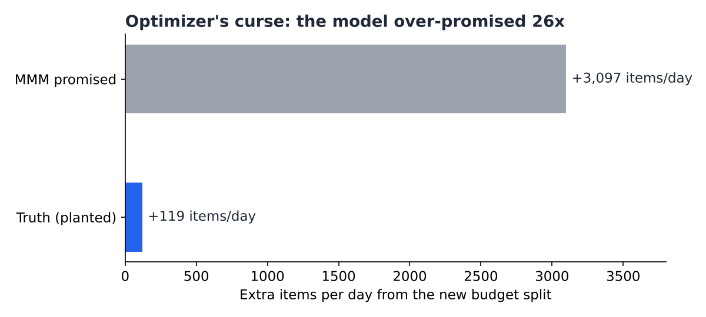

# Meridian: one retailer, every data-science job

Meridian is a fictional fashion retailer built on the real **H&M Kaggle dataset**: 31.8M transactions, 1.37M customers and 105k products, from Sep 2018 to Sep 2020. I worked it end to end the way an analytics team would: diagnose the decline, model customers, run experiments, price, forecast, recommend, put a € value on it all, and ship it as a monitored weekly pipeline on Databricks.

**Headline:** sales fell 12%, and it started *before* COVID. The models together are worth **€3.73m a year** (3% of gross margin). Avoiding two bad policies is worth far more: a blanket 50%-off sale (**−€9.8m**) and "never run out" ordering (**−€65m**).



## Read these first (5 minutes)

| File | What it is |
|---|---|
| [`docs/boardroom/ceo_one_pager.md`](docs/boardroom/ceo_one_pager.md) | Five problems ranked by €, with a Monday-morning action for each |
| [`docs/findings.md`](docs/findings.md) | Every lesson's key numbers, in order, including the corrections |
| [`docs/boardroom/interview_stories.md`](docs/boardroom/interview_stories.md) | Bugs caught, negative results and how I handled them |
| [`docs/lessons/`](docs/lessons/) | Plain-English explainers for lessons 44–56 |

## The 13 modules

| Module | Business question | Methods | Key result |
|---|---|---|---|
| **M0** Data platform | Can we trust and scale the data? | Polars, Parquet, cleaning rules; Databricks medallion (bronze/silver/gold), Unity Catalog | 31.8M rows; laptop and Databricks counts match exactly |
| **M1** Diagnose the decline | Why are sales down 12%? | YoY, driver trees (customers × visits × basket), before/during-COVID split, cohorts | Already −11% before COVID; tops and trousers = 92% of the loss; T-shirts −31%, mostly from 20% fewer designs; online shrank fastest |
| **M2** Customers | Who is the money? | RFM, K-means, simple CLV | Champions + Loyal = 45% of customers, 81% of spend; top 20% of last year's spenders = 59% of next year's money |
| **M3** Churn | Who is leaving, and who is worth saving? | Logistic, LightGBM, feature engineering, SHAP, expected-profit targeting | AUC ~0.80 (ceiling set by the features, not the model); target by profit, not risk |
| **M3.5** Activation | Get audiences into ad tools | Gold audience table, consent filter, FastAPI mock ad platform, idempotent push | Consent cuts reach to 36%; pushes are batched and re-runnable |
| **M4** Experiments | Does the voucher work? | A/B test, CIs, power, A/A, SRM, peeking simulation | Save rate 17.7–20.9% (truth 20%); peeking inflates false wins from 5% to 27.6% |
| **M5** Uplift + MMM | Who does marketing *change*? Where should budget go? | T-learner uplift; adstock + saturation MMM; budget optimizer | Uplift saves ~20% more per voucher; MMM promised +3,097 items/day, truth was +119 (optimizer's curse) |
| **M6** Pricing | What do discounts really do? | Elasticity regression, event study, randomised price test, clearance optimisation | Regression gave the wrong sign (+0.14); the test recovered −1.2; per-item clearance +1.7% vs flat 50% −16.3% |
| **M7** Forecasting | How much should we order? | Seasonal baselines, global LightGBM, quantile vs past-miss ranges, newsvendor | Seasonal 8.4% WAPE ≈ ML 8.6%; honest ranges 88% coverage vs quantile 44%; "never run out" keeps 29% of profit |
| **M8** Recommender | What will each customer buy next week? | Popularity, buy-again, item pairs, candidates + LightGBM ranker | Hit rate 6.43% → 11.54%; candidate recall caps it at 23.96% |
| **M9** Computer vision | Do product photos help? | CLIP ViT-B/32 embeddings, visual candidates, fair control | Visual candidates lose to "5 more bestsellers" (24.55% vs 24.75%): an honest negative |
| **M10** NLP + GenAI | Text similarity, cold start, LLM copy | MiniLM vs TF-IDF, cold-start ranking, local SmolLM2-360M with grounding check | MiniLM 80.1% vs TF-IDF 72.2%; new items 3× random; LLM summaries only 68% grounded |
| **M11** Finance + anomalies | What is it all worth? What is odd? | P&L, € value per lesson; rolling z, seasonal MAD, Isolation Forest | €3.73m/yr total; Black Friday 5.6×; 5,406 sales at exactly 80% off |
| **M12** MLOps | Can it run every Monday, safely? | MLflow tracking + registry, data checks, PSI drift, Databricks job + Unity Catalog | Tracking found a non-determinism bug; byte-identical reruns; Databricks AUC 0.7964 vs local 0.7965; job runs in 190 s |
| **M13** Boardroom | So what? | CEO one-pager, README, interview stories | This page |





## What I'd point a reviewer to

- **Corrections are kept, not hidden.** The voucher value was first calculated on revenue (€10.1m) and then fixed to margin (€2.75m). The photo similarity score was flattered by colour variants (73.8% → 70.5%). The ranker result changed from 11.52% to 11.54% after I found a tie-breaking bug.
- **Baselines first.** Seasonal naive beat or tied ML in forecasting. Rules did most of the recommender's work.
- **Causality over correlation.** Only randomised tests got pricing and voucher effects right.

## Tech stack

Python · Polars · DuckDB · scikit-learn · LightGBM · SciPy · sentence-transformers (MiniLM) · open_clip (CLIP) · Hugging Face Transformers (SmolLM2) · MLflow · FastAPI · Databricks (Spark, Unity Catalog, Jobs) · Matplotlib · Git

## How to run

```bash
python -m venv .venv && .venv\Scripts\activate      # Windows
pip install -r requirements.txt
# Download the H&M data from Kaggle (h-and-m-personalized-fashion-recommendations)
# into data/raw/ (articles.csv, customers.csv, transactions_train.csv)
python scripts/convert_to_parquet.py
python scripts/clean_customers.py
python scripts/clean_transactions.py
python scripts/<any lesson script>.py               # e.g. churn_lightgbm.py, reco_ranker.py
python scripts/weekly_pipeline.py 2020-09-23         # the full weekly batch
```

Scripts are seeded and contain asserts. `data/` is gitignored, so no raw or customer-level data is committed. The Databricks notebooks in `databricks/` use an OAuth CLI profile, so no tokens are stored in the repo.

## Limitations

- **Prices are disguised** in the dataset, so € values use stated assumptions (1 unit = €590, 50% margin). Read them as relative, not exact.
- **Marketing spend, voucher responses and the price test are simulated** with a planted truth, so every method can be checked against the right answer. Real campaigns would need real experiments.
- No stock, returns or size data. Image downloads hit Kaggle rate limits (1,935 of 3,000 photos), so the vision results use a subset.
- Small CPU-only models (laptop). GPU, batching and a bigger LLM would change speed, not the conclusions.

---
Built by **Vivek**, MSc Business Analytics (University of Galway). Open to Data / Business / Marketing Analyst roles in Ireland.
